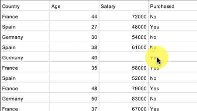

#Data Processing

  

Data => 80% Training Data Set and 20% test set  

## Feature Scaling  
Feature Scaling does always on columns, never on rows (i.e. cross columns). Main Feature Scaling techniques
 

####Normalization:
X => every single value of a column. Range between [0;1]    

####Standardization:   
Subtract the average and divide by standard deviation. Range between [-3;3]    
(X - avg)/Standard Deviation   

 

 

numpy: Arrays etc  
matplotlib: plat chart  
pandas: metrices etc  

  

In a dataset (Say a CSV file),  say based on certain parameter want to predict if a customer will purchase the car   
independent variable: each column  eg, country, age, salary for the customer 
dependent variable: based on the independent variable, somthing you predict like, if customer will purchase the car  

