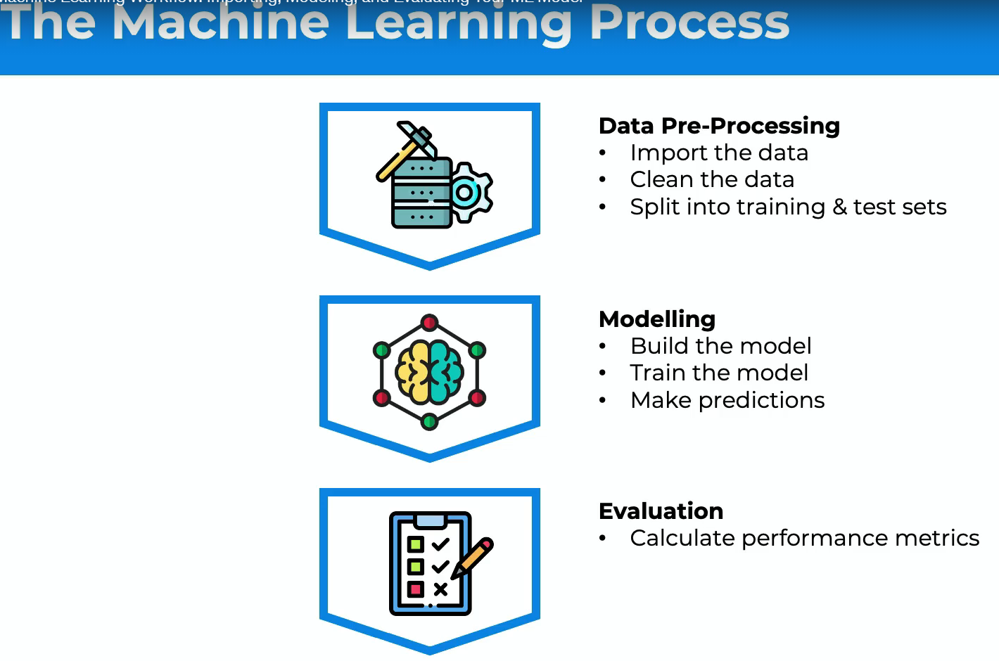
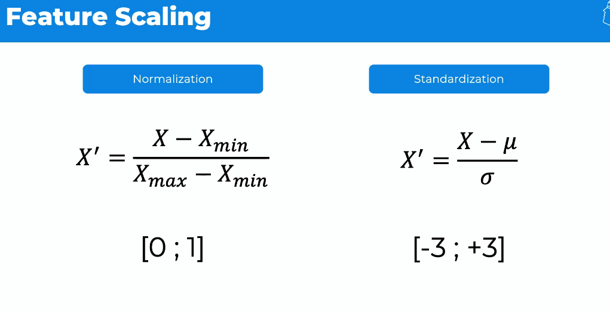
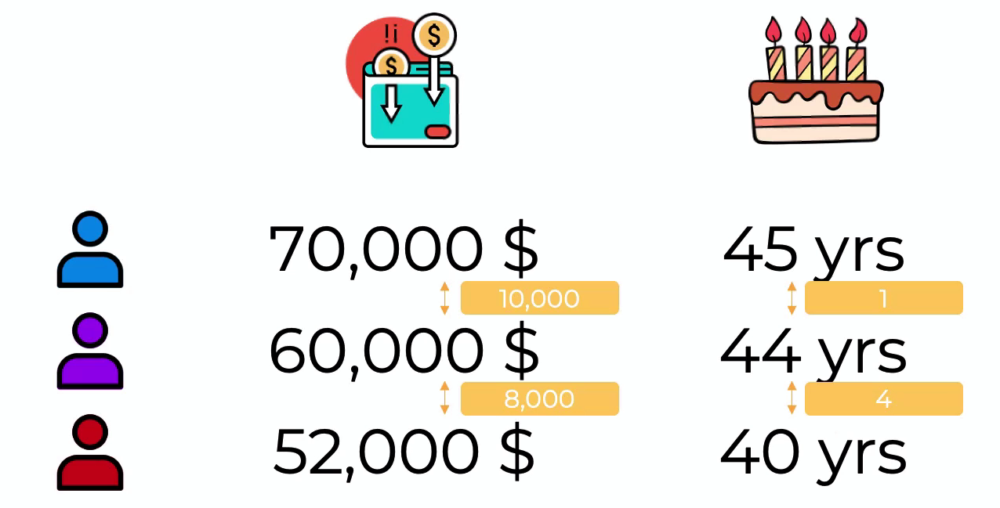
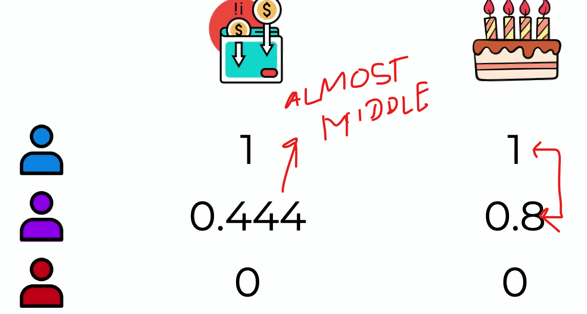

#Data Processing

  

Data => 80% Training Data Set and 20% test set  

## Feature Scaling  
Feature Scaling does always on columns, never on rows (i.e. cross columns). Main Feature Scaling techniques
 

####Normalization:
X => every single value of a column. Range between [0;1]    

####Standardization:   
Subtract the average and divide by standard deviation. Range between [-3;3]    

 

 

