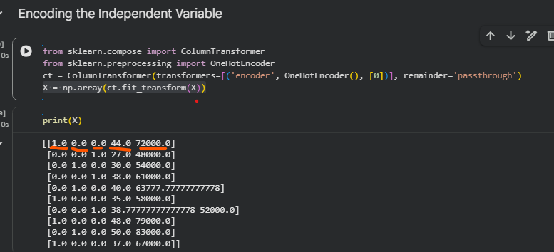

# Data Processing

Note: The mean value (or arithmetic mean) is the average of a set of numbers. You calculate it by adding all the values together and then dividing that sum by the total number of values in the set.  

Note: Standard deviation is a statistical measure that tells you how much the numbers in a data set spread out from the average (mean). . A low standard deviation means the values stay close to the mean. A high standard deviation means the values scatter over a much wider range.  

Note: Scalar Quantity: Described by a single number with a unit of measurement (e.g., \(50\text{ kg}\)). It does not point anywhere.  

Note: Vector Quantity: Described by a number, a unit, and an orientation in space (e.g., \(50\text{ m/s}\) to the north). Represented graphically by an arrow  


  

Data => 80% Training Data Set and 20% test set  

## Feature Scaling  
Feature Scaling does always on columns, never on rows (i.e. cross columns). Main Feature Scaling techniques
 

#### Normalization:
X => every single value of a column. Range between [0;1]    

#### Standardization:   
Subtract the average and divide by standard deviation. Range between [-3;3]    
(X - avg)/Standard Deviation   


 

 

numpy: Arrays etc  
matplotlib: plat chart  
pandas: metrices etc  

  

In a dataset (Say a CSV file),  say based on certain parameter want to predict if a customer will purchase the car   
independent variable: each column  eg, country, age, salary for the customer 
dependent variable: based on the independent variable, somthing you predict like, if customer will purchase the car  


``` 
X = dataset.iloc[<row>, <column>].values  => independent variables
X = dataset.iloc[:, :-1].values
: => left and right of : is EMPTY means all rows 
:-1 => Index of last column


y = dataset.iloc[:, -1].values => dependent variable
-1 => Index of last column => So only last column  
```

### Generate Missing Data  
Option 1: delete the row which has missing data. This works if we have large dataset.  
Option 2: Replace the missing value by averaging the other values (or some other approach say most recent value  or mean value etc) of that column and update missing cell.   

sklearn library: it has lots of data pre-processing tools incl data pre-processing tools.  
``` 
from sklearn.impute import SimpleImputer
imputer = SimpleImputer(missing_values=np.nan, strategy='mean')
imputer.fit(X[:, 1:3])
X[:, 1:3] = imputer.transform(X[:, 1:3])


imputer = SimpleImputer(missing_values=np.nan, strategy='mean') 
Means: "missing_values=np.nan" mean which cells we will consider, here, values cell value is nan mean EMPTY. np is numpy library  
Here we using strategy "mean" to replace missing value
imputer.fit(X[:, 1:3]) => Remember x was for independent columns. 1:3 means Age and Salary column

```

### Encoding categorical data
In the csv above, we have one column "category", it is difficult for ML model to compute the correlation between these columns and outcome i.e. dependent variable. So need to convert them from String to number. As there is no relationship order (Say, incremental order) for that column. So France itself will have different number assigned. 

  

Here, we have 3 countries, so it breaks into 3 classes/categories each of them is for 1 country, say France is column 0, Spain is column 1 and Germany is column 2.
So, row for France: 1,0,0. This is OneHot Encoding consist of binary vectors for each countries.   

``` 
ct = ColumnTransformer(transformers=[('encoder', OneHotEncoder(), [0])], remainder='passthrough')

3 arg:
1. Type of transformation => we using encoding
2. What type of encoding => OneHotEncoder
3. Indexs of columns => we have "country"


remainder='passthrough' => Means, it will keep all other columns here, age and salary, alo g with 3 new columns; if we dont mention it, will keep only 3 columns.
```

``` 
To encode dependent variable:

le = LabelEncoder()
y = le.fit_transform(y) => remember y was dependent variable above

Output:
[0 1 0 0 1 1 0 1 0 1]
```

### Splitting Data: Training vs Test Sets
Note: The ques if we need to apply data split bfore or after feature scaling?  
The community has mixed feedback on this. We should apply feature scaling after data split. Reason:  the Feature scaling should be applied on training data set, if we appy before the split then it will apply on both, there will be information leakage to test data set Ideally test data set should be a new data set.  

``` 
X_train, X_test, y_train, y_test = train_test_split(X, y, test_size = 0.2, random_state = 1)  

random_state => Controls the randomness of how your dataset is split into training and testing sets.
```

### Feature Scaling  
Feature Scaling allow to put all our features in same scale. We wont have to apply Feature Scaling to all our ML model. Standardization, Normalization (explained above).

Should we go for Standardization or Normalization?    
Normalization is recommended when we have normal distribution in most of your features. Standardization works well all the time.  So, Standardization is my recommendation.  The feature scaling will be applied to X_train.  

Question: Do i need to apply Standardization on dummy variables (like country we converted into: 0,0,1/0,1,0/1,0,0)?   
Answer: Not required. Remeber the goal of the feature scaling - i.e. keep all values in same range. 
Applying Standardization on dummy variables wont improve accuracy as such.  Only apply feature scaling on numerical columns, here, age and salary.    

``` 
sc = StandardScaler()
X_train[:, 3:] = sc.fit_transform(X_train[:, 3:])
X_test = sc.transform(X_test)
```

``` 
In Scikit-learn, the main difference is:

- `fit_transform()`: Learns the transformation parameters from the data and transforms the data.
- `transform()`: Uses already-learned parameters to transform the data.

Example:
X_train = sc.fit_transform(X_train)
X_test = sc.transform(X_test)

Suppose you are using `StandardScaler()` to scale your data.

| Method            | What it does                                          | When to use           |
| ----------------- | ----------------------------------------------------- | --------------------- |
| `fit()`           | Learns parameters such as mean and standard deviation | Training data         |
| `transform()`     | Scales data using learned parameters                  | Training or test data |
| `fit_transform()` | Performs both `fit()` and `transform()`               | Training data         |

## How it works

1. Training data

`sc.fit_transform(X_train)`

Learns the mean and standard deviation, then scales the training data.

2. Test data

`sc.transform(X_test)`

Uses the same training mean and standard deviation to scale the test data.

### Why not use `fit_transform()` on both?

If you use `fit_transform()` on `X_test`, the scaler learns new parameters from the test data. This can cause data leakage and make your model evaluation unreliable.

Remember this simple rule:

- Training data → `fit_transform()`
- Test data → `transform()`

This ensures both datasets use the same scaling rules.

```

When the dependent variable has binary values (0 and 1), feature scaling is generally not required for it. However, when the dependent variable has very high values compared to the other features, feature scaling may be needed to bring them into a similar range.


