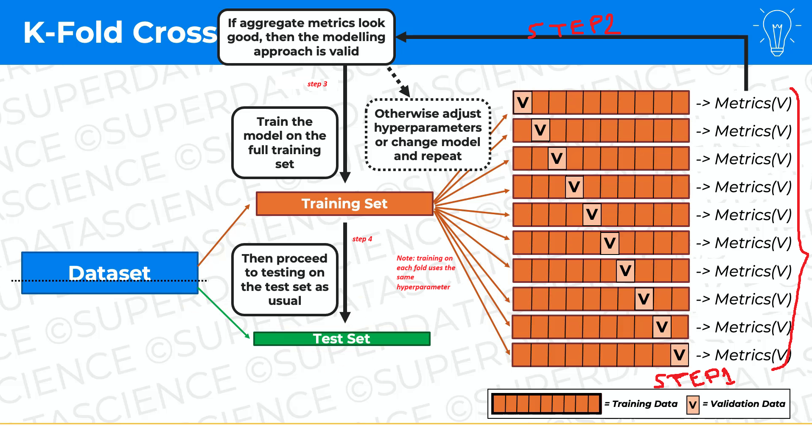
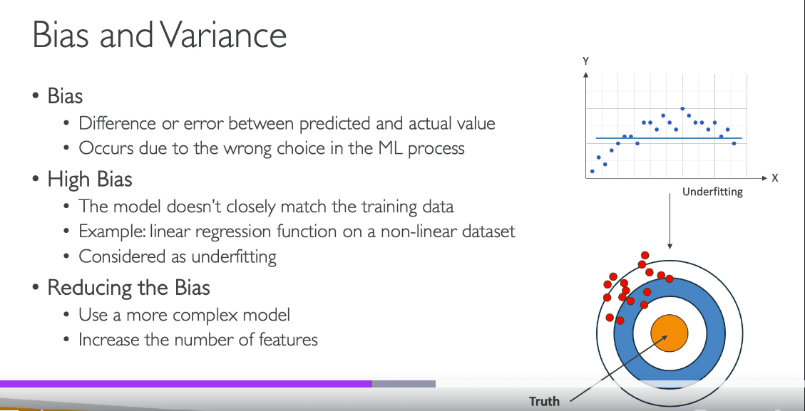
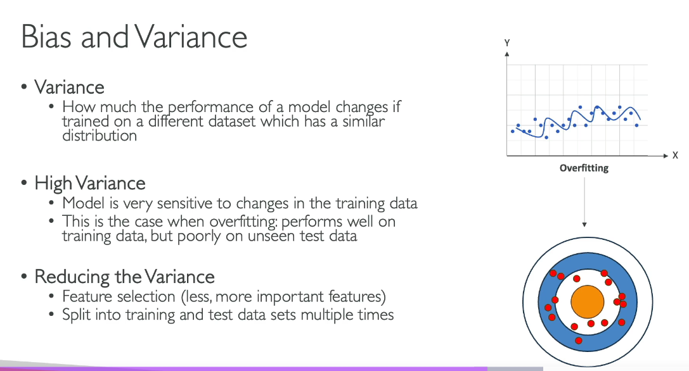
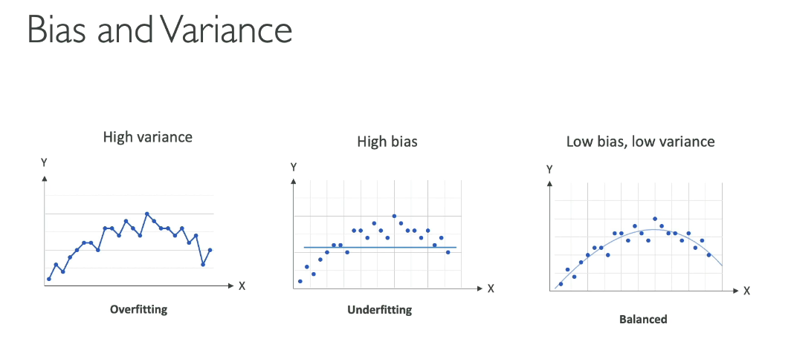
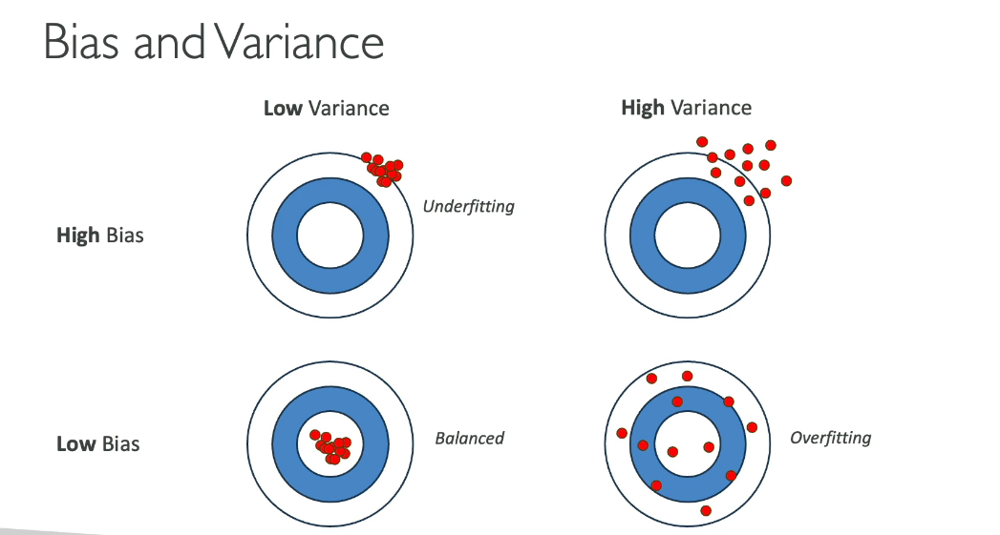
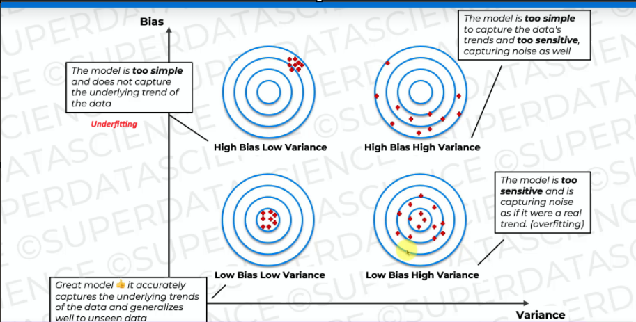

# Model Selection and Boosting  

After we built our Machine Learning models, some questions remained unanswered:  

How to deal with the bias variance tradeoff when building a model and evaluating its performance ?  
How to choose the optimal values for the hyperparameters (the parameters that are not learned) ?  
How to find the most appropriate Machine Learning model for my business problem ?  

In this part we will answer these questions thanks to Model Selection techniques including:  
k-Fold Cross Validation  
Grid Search  

## k-Fold Cross Validation  
2 types of thought:
1. Split the data into training set and test set , use traing set for k-Fold Cross Validation  and later use test set  
2. Dont need test set  

Will follow approach 1  

Assume k=10 for simplicity  i.e. split the data into 10 parts and will take one part out of 10 for validation (marked as V below)  

## bias variance  trade off

i.e. Bias: Model itself never performing well i.e. underfitting    
Variance: Model performs well on trainug data but not well with test data  

