# Regression

**Algorithm vs Model**
Simple Linear Regression is both an ML algorithm and a type of model, depending on the context.
- Algorithm: The method used to learn the relationship between input \(X\) and output \(Y\) by finding the best-fit straight line.
- Model: The learned equation used to make predictions after training.


## Simple Linear Regression


   

### Ordinary Least Squares  
How do we know which of the slope line is the best one. To know we use Ordinary Least Squares.  

   
We have our data poins and then from there projet them virtically on liener regression line. We need to do this for every single line. For each pair of points we have 2 values. 


``` 
from sklearn.linear_model import LinearRegression
regressor = LinearRegression()
regressor.fit(X_train, y_train) => fit() used to train our regression model i.e. byrunning we trained the regression model.
```

### Predicting the Test set results
We have considered 20% is test data set, so according to that 6 records are part of test set. We will calculate the predicted salry for these 6 records and compare that against **ground truth i.e. actual salary** of these 6 records (highligted below). 


``` 
y_pred = regressor.predict(X_test) 
```

### Visualising the Training set results
```
import matplotlib.pyplot as plt
plt.scatter(X_train, y_train, color = 'red') => actual data plot
plt.plot(X_train, regressor.predict(X_train), color = 'blue') => actual regression line plot on trainig dataset. to userstand "regressor.predict(X_train)" pls see above
plt.title('Salary vs Experience (Training set)')
plt.xlabel('Years of Experience')
plt.ylabel('Salary')
plt.show()
```

### Visualising the Test set results
``` 
plt.scatter(X_test, y_test, color = 'red')
plt.plot(X_train, regressor.predict(X_train), color = 'blue') ************* => This has to be X_train and it MUST not replace with X_test. Reason: This is baseline. The preicted salary will be on the same regresion line. 
plt.title('Salary vs Experience (Test set)')
plt.xlabel('Years of Experience')
plt.ylabel('Salary')
plt.show()
```

Question 1: How do I use my simple linear regression model to make a single prediction, for example, to predict the salary of an employee with 12 years of experience?  
Answer: 
``` 
print(regressor.predict([[12]]))
```

Question 2: How do I get the final regression equation y = b0 + b1 x with the final values of the coefficients b0 and b1?  
Answer:  
``` 
print(regressor.coef_)
print(regressor.intercept_)
```

Question:  
We should use Simple Linear Regression to predict the winner of a football game  True/False?  
Ans: False. Simple Linear Regression predicts continuous numerical values. Predicting the winner of a football game is a classification problem, so Logistic Regression or another classification algorithm is more appropriate.  

What is the constant in simple linear regression?   
Ans: It is where the line crosses the vertical axes  

Which of the following formulas is not a simple linear regression model?
Ans: Salary = a*Experience + b*Age 

Note: Salary = a*Experience and a*Experience + b are the formulas of simple linear regression  


## Multiple Linear Regression  
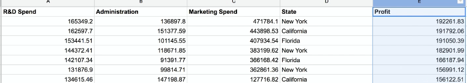

Now we want to identify which of this spend (R&D and Marketing), providing better impact on profit etc.

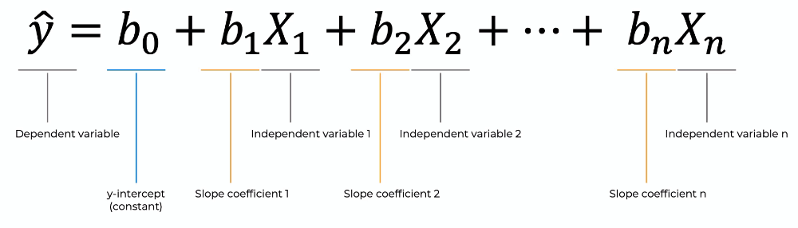
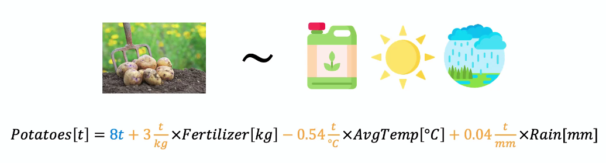
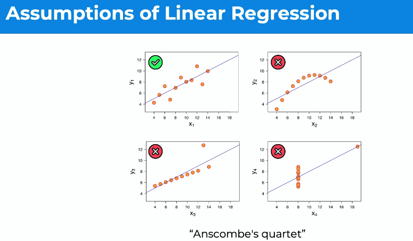
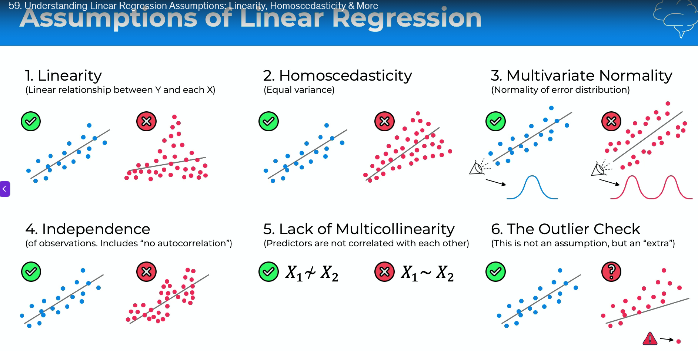


### Dummy Variables
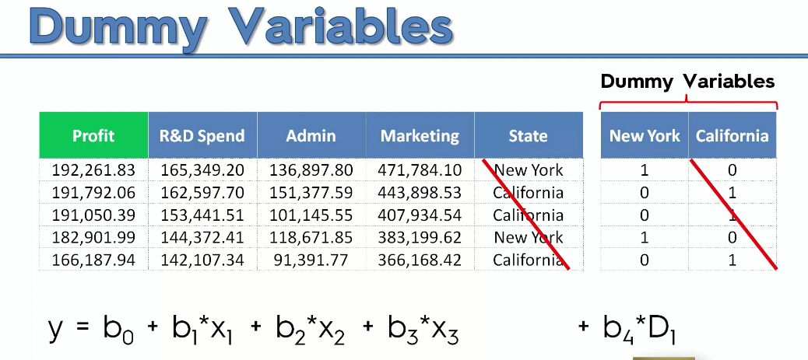
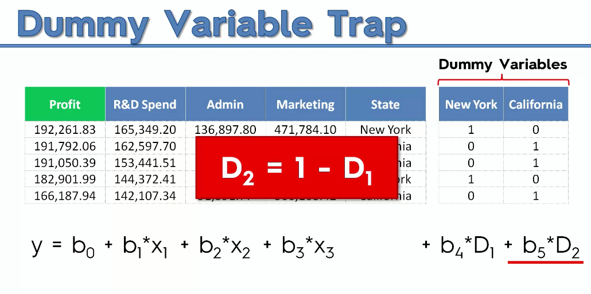
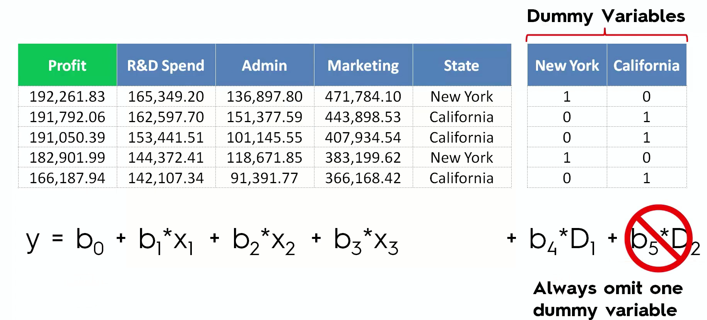
Pls note, constant (b0) and both dummy variables (D1 and D2) can not present at the same time. If we have 9 Say 9 countries), then we should have 8, if we have 99 then we should have 98. If we have 2 sets then we should apply same rule to each set.  

### P-Values ad Statistical Significance 
P-Values = Probability 
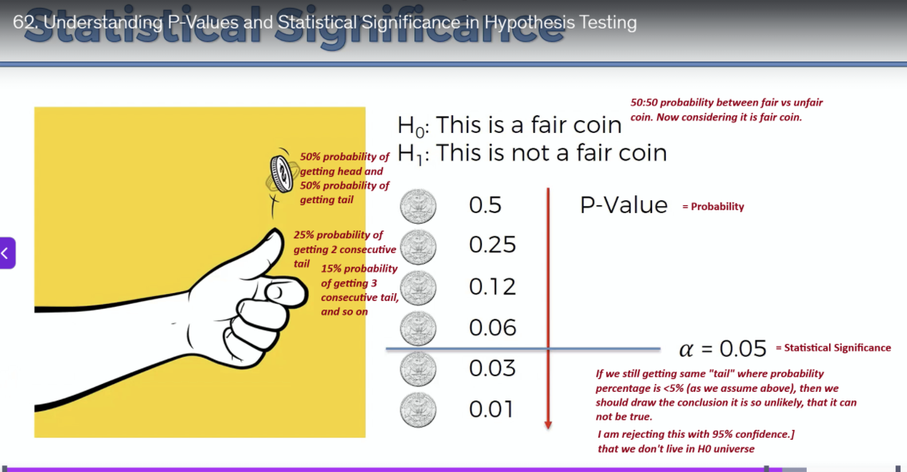


### Building Robust Multiple Linear Regression Models 
We have lots of columns are potentials predictors for our dependent variable. We need to decide which one we want to keep and which one we want to throw out. 
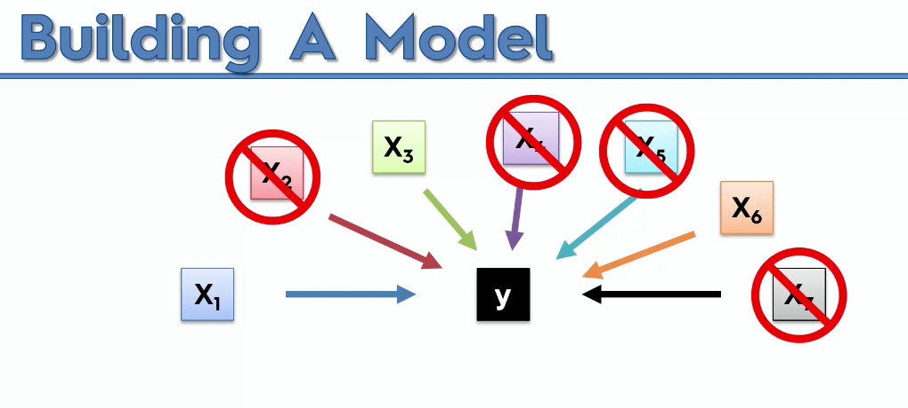

Reason why we want to throw out few columns:  
1. Garbage in and out  
2. Explanability  

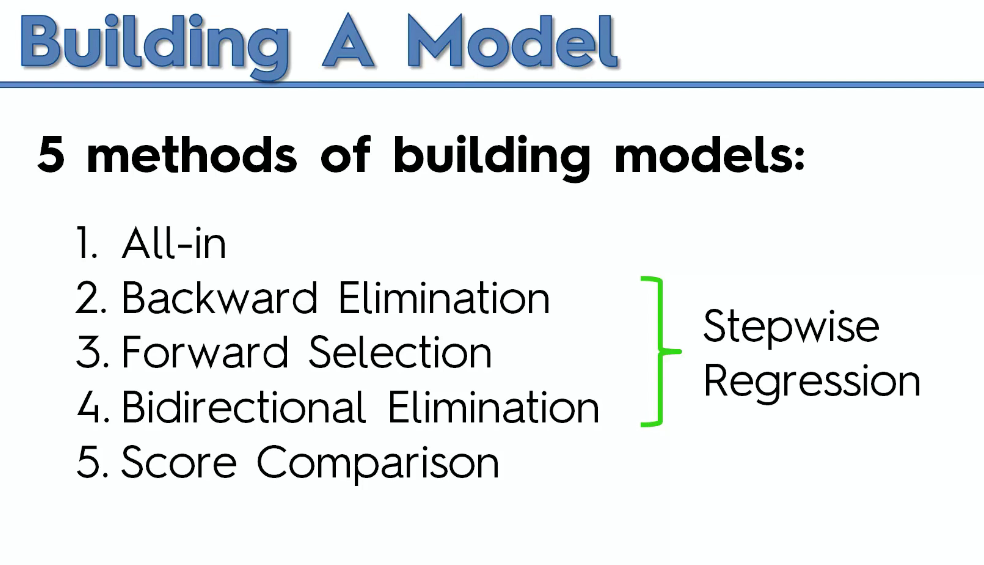

#### All-in: 
Throw in all your variables using prior knowledge or keep as per industry standard or some framework within your company

#### Backword Elimination:
Fastest one  
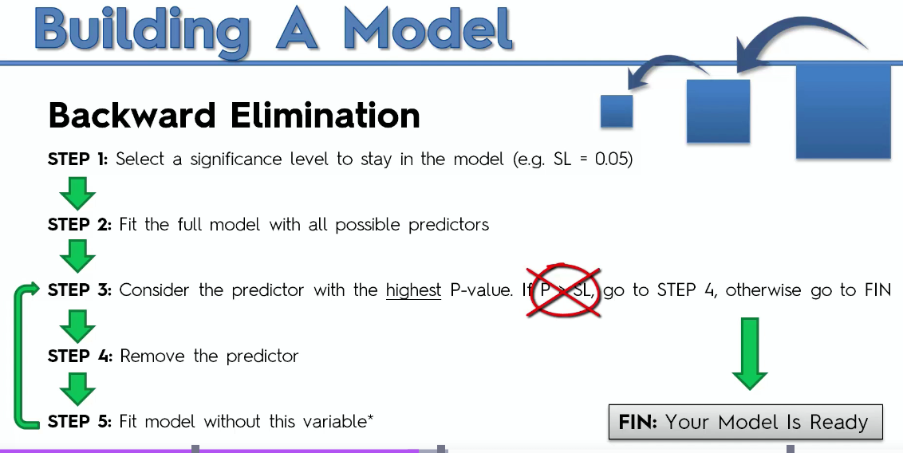

#### Forward Selection:    
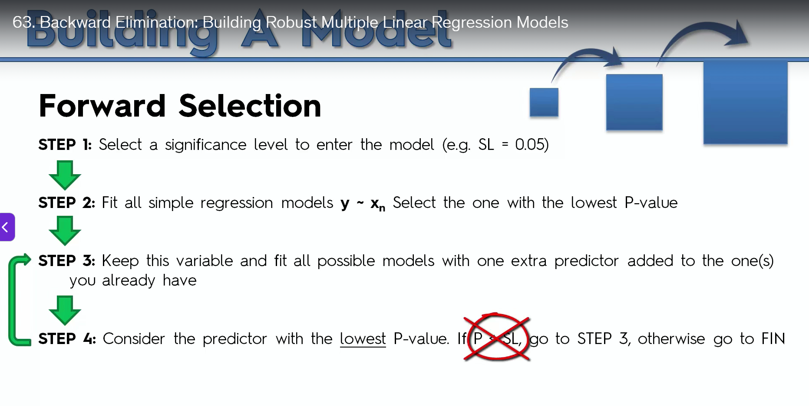

#### Bidirectional Elimination:   
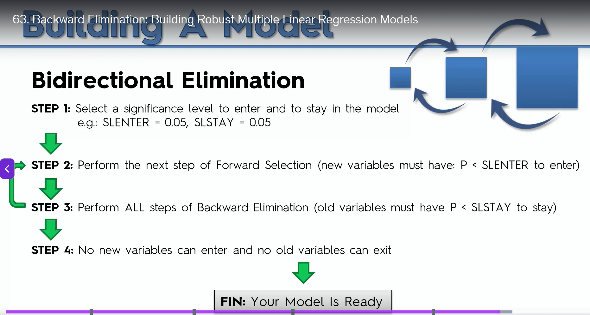

#### All Possible Models
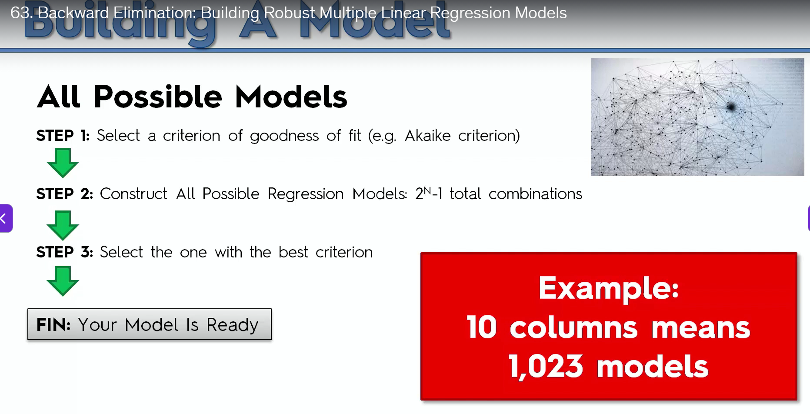

NOTE: In Multiple Liner Regression we dont have to apply feature scaling. It has co-efficient (b1, b2 etc) that multiplied to each feature. So, it does not matter if some feature has higher value than another, CO-efficient will compensate everything.  

Do we have to check assumptions of liner regressions? 
The answer is absolutely not, because whenever you have a new data set, and you want to experiment with some machinery models to figure out which one leads to the highest accuracy, even if your data set doesn't have linear relationships, you can still try a Multiple Linear Regression on it. And, if you know your data set doesn't have linear relationships, well, your Multiple Linear Regression model will just perform poorly, and therefore, it will get an accuracy lower than the accuracies of your other models. So, you will just not select the Multiple Linear Regression model, but you don't have to check the Multiple Linear Regression assumptions. It will just be a waste of time.   

Question: Do we have to do something to avoid dummy variable trap?   
Ans: No, in Multiple Linear Regression the class that you will import, will automatically avoid this trap i.e. implicitly it will handle, no explicit changes required.   

Question: Do we have to work on the features to select the best ones with the techniques like, backward elimination?
Ans: No. Well, for the exact same reason as the dummy variable trap. The class that we're about to call to build our Multiple Linear Regression model will automatically identify the best features, you know the features that have the highest P values or that are the most statistically significant to figure out how to predict the dependent variable, you know the profit with the highest accuracy. So once again, you don't have to worry about this. The class of (indistinct), you know this amazing data science library will take care of everything for you.  

And now actually, I have some good news because, you know, we're still doing linear regression. And in the previous section we actually did simple linear regression, with which we therefore had one feature in our data set, and now we're doing multiple linear regression, which is exactly the same as simple linear regression except that we have several features. So the good news is actually that the class that we're about to use to build and train this Multiple Linear Regression model is actually the exact same class as for the Simple Linear Regression model, it will just recognize that there are several features and therefore that we are doing multiple linear regression, but the rest will be exactly the same.  

``` 
Training the Multiple Linear Regression model on the Training set

from sklearn.linear_model import LinearRegression
regressor = LinearRegression()
regressor.fit(X_train, y_train)
```

Unlike, Simple liner regression, for Multiple Liner regression, we can not plot this in 2D graph, as we have 4 independent variable, required 5D graoh considering the output also in 1 dimension.   

Now, let's predict the test set results. We're gonna display two vectors. First one being the vector of the real profits and the test set, and the second one being the vector of the predicted profits in the same test set. And we're gonna compare next to each other, to see if our predictions are close to the real results.  
print(np.concatenate((y_pred.reshape(len(y_pred),1), y_test.reshape(len(y_test),1)),1))
``` 
y_pred = regressor.predict(X_test) => prediction for test data
np.set_printoptions(precision=2) => set precision to 2.np is numpy instance 
print(np.concatenate((y_pred.reshape(len(y_pred),1), y_test.reshape(len(y_test),1)),1)) => NumPy concatenate uses to concatenate vectors or arrays virtically or horizontally. Reshape used to reshape arrays or vectors. 

y_pred.reshape(len(y_pred),1) --> That means you want to reshape your Y pred vector into an array, having len Y pred rows, meaning you know that the number of rows will be equal to the number of startups, and then just one column.

The last "1": it can be 0 or 1, based on that it uses horizontal ir virtical concatination. 
```

Note: As I explained in the previous tutorial, Backward Elimination is irrelevant in Python, because the Scikit-Learn library automatically takes care of selecting the statistically significant features when training the model to make accurate predictions. However, if you do really want to learn how to manually implement Backward Elimination in Python:
https://www.dropbox.com/sh/pknk0g9yu4z06u7/AADSTzieYEMfs1HHxKHt9j1ba?dl=0


Question: Making a single prediction (for example the profit of a startup with R&D Spend = 160000, Administration Spend = 130000, Marketing Spend = 300000 and State = 'California') 
Answer:  
``` 
print(regressor.predict([[1, 0, 0, 160000, 130000, 300000]]))
```

Therefore, our model predicts that the profit of a Californian startup which spent 160000 in R&D, 130000 in Administration and 300000 in Marketing is $ 181566,92.

Important note 1: Notice that the values of the features were all input in a double pair of square brackets. That's because the "predict" method always expects a 2D array as the format of its inputs. And putting our values into a double pair of square brackets makes the input exactly a 2D array. Simply put:
```
1,0,0,160000,130000,300000→scalars
[1,0,0,160000,130000,300000]→1D array
[[1,0,0,160000,130000,300000]]→2D array
```

Question: Getting the final linear regression equation with the values of the coefficients:
``` 
print(regressor.coef_)
print(regressor.intercept_)

O/P:
[ 8.66e+01 -8.73e+02  7.86e+02  7.73e-01  3.29e-02  3.66e-02]
42467.52924853204

Therefore, the equation of our multiple linear regression model is:
Profit=86.6×Dummy State 1−873×Dummy State 2+786×Dummy State 3+0.773×R&D Spend+0.0329×Administration+0.0366×Marketing Spend+42467.53
```

Ques: We should use Multiple Linear Regression to predict a dependent variable that is growing exponentially with time. Yes/No?    
Ans: No. Multiple Linear Regression models linear relationships. For a dependent variable growing exponentially with time, Exponential Regression is generally more appropriate.    

Ques: In Multiple Linear Regression is the DV represented by Y?  
And: Yes  

## Polynomial Linear Regression:

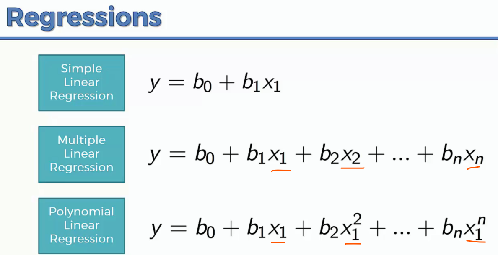

In the below example, Simple liner regression does not fits well. Rather Polynomial Linear Regression fits well.   
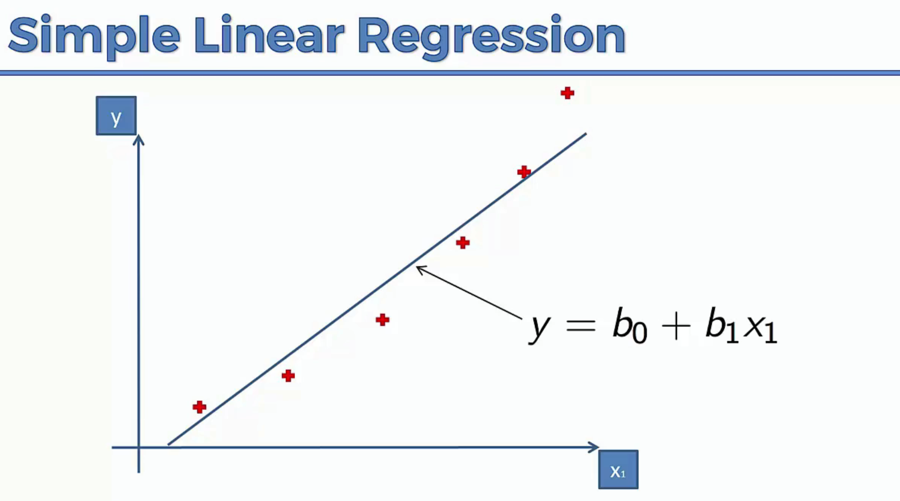

Example of Polynomial regression, how pandemic spread well.   

Why is it linear?
This is non-liner regression model. Polynomial regression is called linear as, when the equation is a linear combination of its coefficients (b0, b1, b2 etc), regardless of whether the input features are transformed (x1 etc which is non-linear i.e. relation between y and x non-linear); therefore, Polynomial Regression is a special case of Multiple Linear Regression, while Nonlinear Regression cannot be made linear with respect to its coefficients.

The example related to experience ve expected salary, is a single independent variable, so we will compare simple liner regression (NOT multiple liner regression) vs Polynomial Linear Regression, and compare both:  

Training the Linear Regression model on the whole dataset  

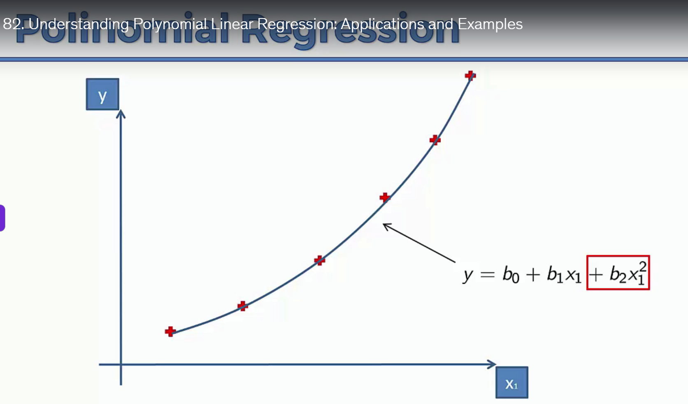


``` 
from sklearn.linear_model import LinearRegression
lin_reg = LinearRegression()
lin_reg.fit(X, y)

# Display
......
plt.plot(X, lin_reg.predict(X), color = 'blue')
......
```
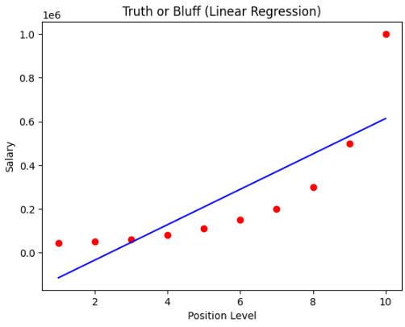

Note: for our problem associate told he is getting 160K salary from his previous compay so need need similar salary
This example we will sue for Polynomial Regression 
If we plot the data points it clearly gives a parabolic ffect, still we will use simple liner regression and Polynomial Regression and compare and eventually we will discard one (simple liner will be identified to discard)  

Training the Polynomial Regression model on the whole dataset  
``` 
from sklearn.preprocessing import PolynomialFeatures
poly_reg = PolynomialFeatures(degree = 2) => degree
X_poly = poly_reg.fit_transform(X) => Level (i.e, 1,2, ...) which is independent variable (Note table has 3 columns, Position, Level, Salary)  
lin_reg_2 = LinearRegression()
lin_reg_2.fit(X_poly, y)

#Display
......
plt.plot(X, lin_reg_2.predict(poly_reg.fit_transform(X)), color = 'blue')
......

```

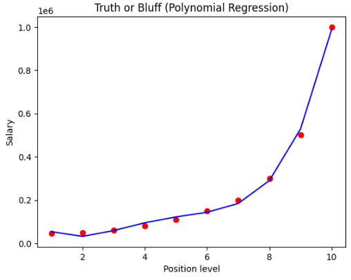


if we use higher value of digree say 4, which will give better result   

``` 
poly_reg = PolynomialFeatures(degree = 4)
```

the formula would be:
y = $b_0$ + $b_1 x_1$ + $b_2 x_1^2$ + $b_3 x_1^2$ + $b_4 x_1^2$

In order to get smoother graph, which will more data points between 2 points 1, 1.1, 1.2 etc...
This migt not needed in real world as we will already have many data points. 

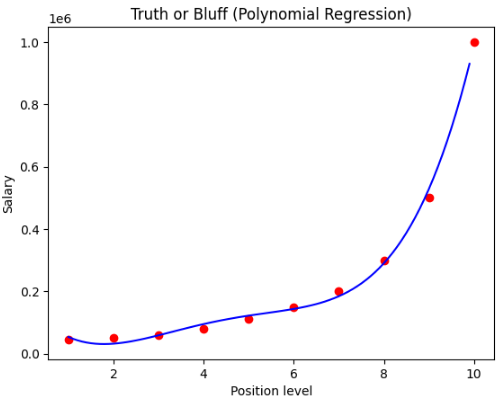


``` 
X_grid = np.arange(min(X), max(X), 0.1)
X_grid = X_grid.reshape((len(X_grid), 1))
plt.scatter(X, y, color = 'red')
plt.plot(X_grid, lin_reg_2.predict(poly_reg.fit_transform(X_grid)), color = 'blue')
plt.title('Truth or Bluff (Polynomial Regression)')
plt.xlabel('Position level')
plt.ylabel('Salary')
plt.show()
```

### Predicting a new result with Linear Regression
lin_reg.predict([[6.5]])  
O/P: array([330378.78787879])  => way higher, cleary did not give good performance 

### Predicting a new result with Polynomial Regression
lin_reg_2.predict(poly_reg.fit_transform([[6.5]]))  
O/P: array([158862.45265155])  => super close result 


