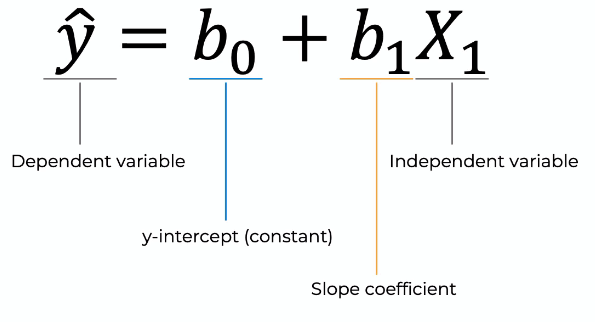
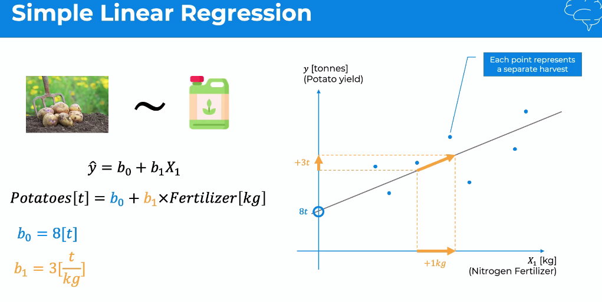
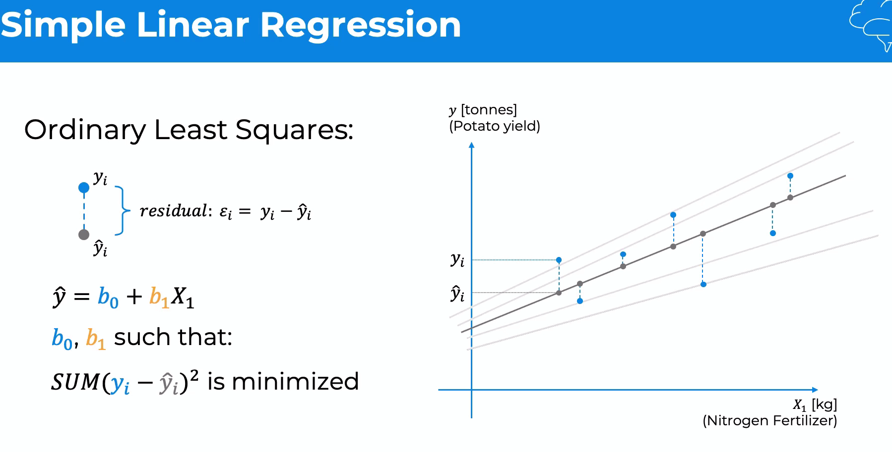
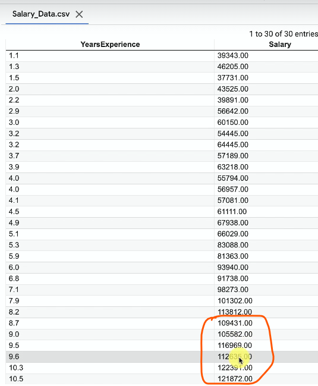

# Regression

## Simple Linear Regression 

Simple Linear Regression is both an ML algorithm and a type of model, depending on the context.
- Algorithm: The method used to learn the relationship between input \(X\) and output \(Y\) by finding the best-fit straight line.
- Model: The learned equation used to make predictions after training.



   

### Ordinary Least Squares  
How do we know which of the slope line is the best one. To know we use Ordinary Least Squares.  

   
We have our data poins and then from there projet them virtically on liener regression line. We need to do this for every single line. For each pair of points we have 2 values. 


``` 
from sklearn.linear_model import LinearRegression
regressor = LinearRegression()
regressor.fit(X_train, y_train) => fit() used to train our regression model i.e. byrunning we trained the regression model.
```

### Predicting the Test set results
We have considered 20% is test data set, so according to that 6 records are part of test set. We will calculate the predicted salry for these 6 records and compare that against **ground truth i.e. actual salary** of these 6 records (highligted below). 



``` 
y_pred = regressor.predict(X_test) 
```

### Visualising the Training set results
```
import matplotlib.pyplot as plt
plt.scatter(X_train, y_train, color = 'red') => actual data plot
plt.plot(X_train, regressor.predict(X_train), color = 'blue') => actual regression line plot on trainig dataset. to userstand "regressor.predict(X_train)" pls see above
plt.title('Salary vs Experience (Training set)')
plt.xlabel('Years of Experience')
plt.ylabel('Salary')
plt.show()
```

### Visualising the Test set results
``` 
plt.scatter(X_test, y_test, color = 'red')
plt.plot(X_train, regressor.predict(X_train), color = 'blue') ************* => This has to be X_train and it MUST not replace with X_test. Reason: This is baseline. The preicted salary will be on the same regresion line. 
plt.title('Salary vs Experience (Test set)')
plt.xlabel('Years of Experience')
plt.ylabel('Salary')
plt.show()
```


