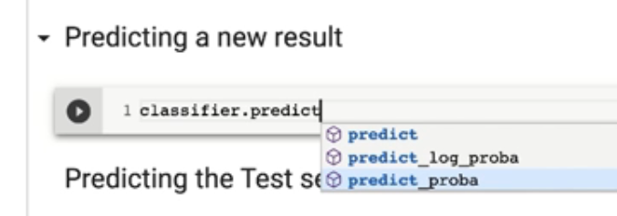
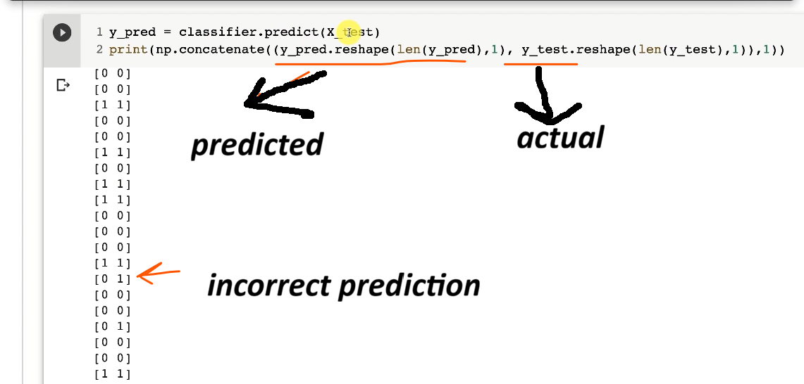
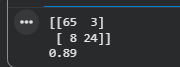
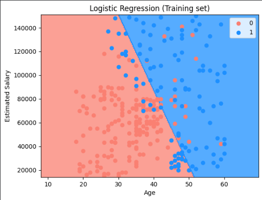
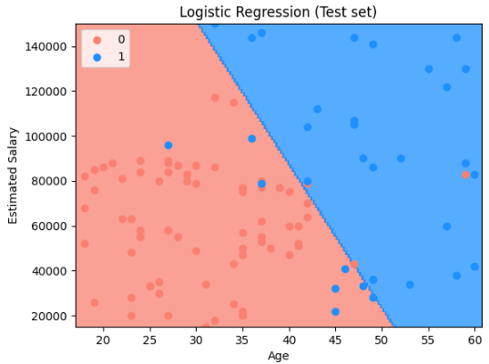

# Classification 
Unlike regression where you predict a continuous number, you use classification to predict a category.  


## Logistic Regression 

Note: Logistic Regression  Model is a liner model.  


###  Maximum Likelihood 
How do we know this is the best curve. 


Sample data: "Purchased" column explains if the customer has purchased any of the previous SUV (dependent variable)
Note: Each dimension in the feature represents a feature, in our example, as we have 2 dimensions (age and salary), we have 2D array.  

### Hands on

``` 
Feature Scaling => We need to fo this for Age and Salary 

from sklearn.preprocessing import StandardScaler
sc = StandardScaler()
X_train = sc.fit_transform(X_train)
X_test = sc.transform(X_test)
```

``` 
Training the Logistic Regression model on the Training set

from sklearn.linear_model import LogisticRegression
classifier = LogisticRegression(random_state = 0)
classifier.fit(X_train, y_train)

Predicting a new result

print(classifier.predict(sc.transform([[30,87000]])))

predict_proba() => probability that the purchase decision is 1
predict() => final probability 0 or 1

Output: [1]
```





###  Confusion Matrix and Accuracy Score 
Simple 2D matrix, which gives us, number of correct vs incorrect predictions  

``` 
Making the Confusion Matrix
from sklearn.metrics import confusion_matrix, accuracy_score
cm = confusion_matrix(y_test, y_pred)
print(cm)
accuracy_score(y_test, y_pred)
```


65 and 24 are number of correct prediction who brought and did not brought the car. 3 and 8 are incorrect predictions.  
89% Accuracy 

### Visualizing the Training and Test set results
Remember, this is liner classifier. This code is advanced, and you will probably will NOT use in future as mostly we will be working with dataset of many features.  

Training Set:  


Test Set:  


A straight-line decision boundary cannot correctly separate all red and green points, even if rotated; non-linear classifiers can create a curved decision boundary to better separate the two classes, reducing incorrect predictions.  

Are you having trouble mastering the basics of Regression and Classification? Mastering these Machine Learning concepts is essential for any data scientist eyeing to succeed.  
https://www.superdatascience.com/blogs/the-ultimate-guide-to-regression-classification

Question: Is probability represented by p_hat? YES  


### K-Nearest Neighbors (K-NN) 


