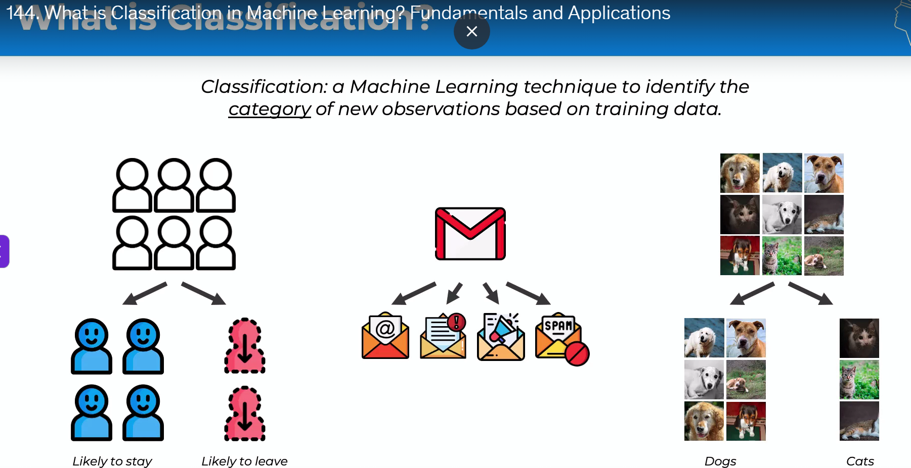
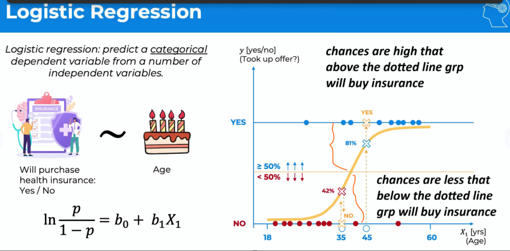
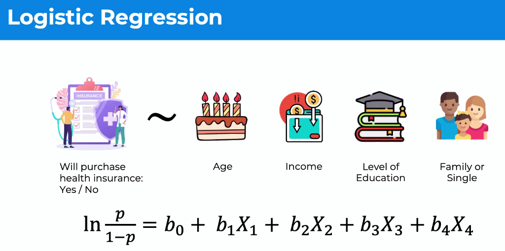
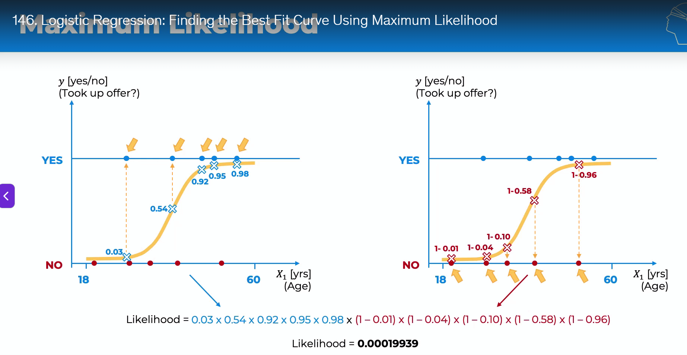
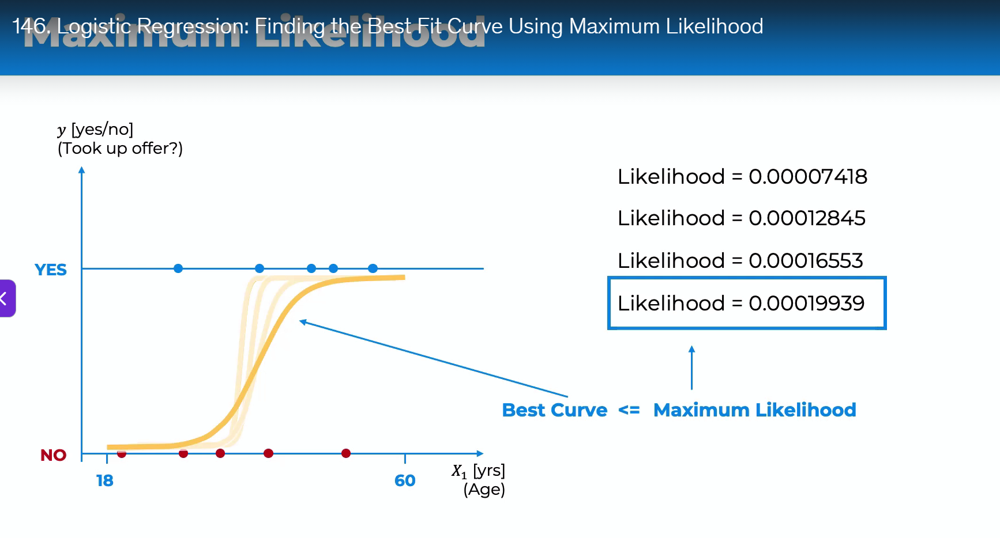

# Classification 
Unlike regression where you predict a continuous number, you use classification to predict a category.  

## Logistic Regression 

###  Maximum Likelihood 
How do we know this is the best curve. 

