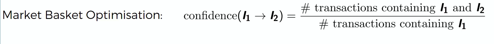
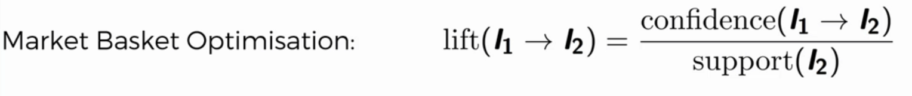
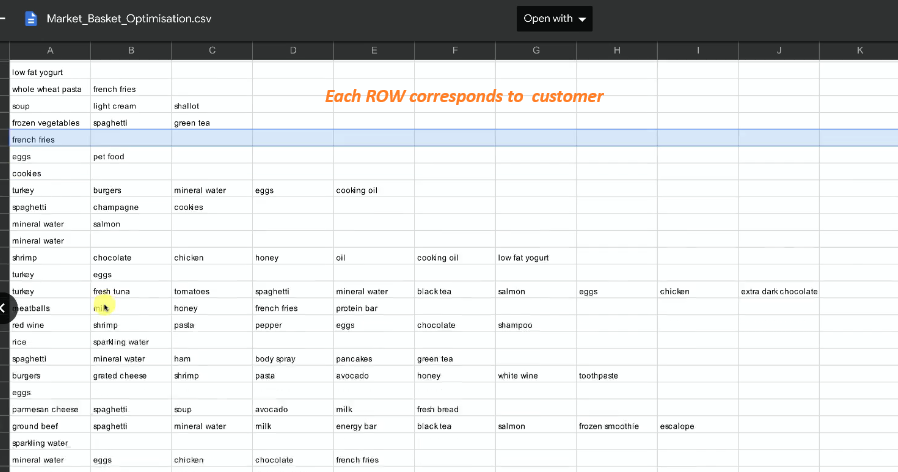

# Association Rule Learning  

People who bought A also bought B. That is what Association Rule.

## Apriori  
Generally, Apriori is an Association Rule Learning algorithm
Apriori algo has 3 parts: supports, confidence and lift

Support:  


Confidence:  
People who brought burger (I1) also brought fries (I2)  


Lift:

Lift = Confidence / Support  

Apriori is bit slow algorithm, so, is a product itself has slow success rate, we might not consider them.


``` 
from apyori import apriori
rules = apriori(transactions = transactions, min_support = 0.003, min_confidence = 0.2, min_lift = 3, min_length = 2, max_length = 2)

min_support, min_confidence, min_lift => case by base basis based on data and business case 

min_length => Min num of elements you want to have left or right
max_length => Max num of elements you want to have left or right

Suppose customers purchase:
- Milk + Bread
- Bread + Butter
- Milk + Bread + Butter
Your Apriori algorithm will identify combinations such as:
- Milk → Bread
- Bread → Milk
- Bread → Butter
- Butter → Bread
It will not consider a three-item combination such as Milk + Bread + Butter.

```
After running the above and format, getting this:  


