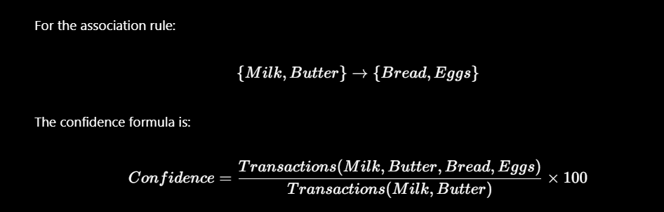
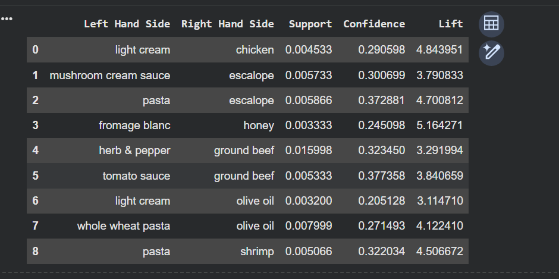
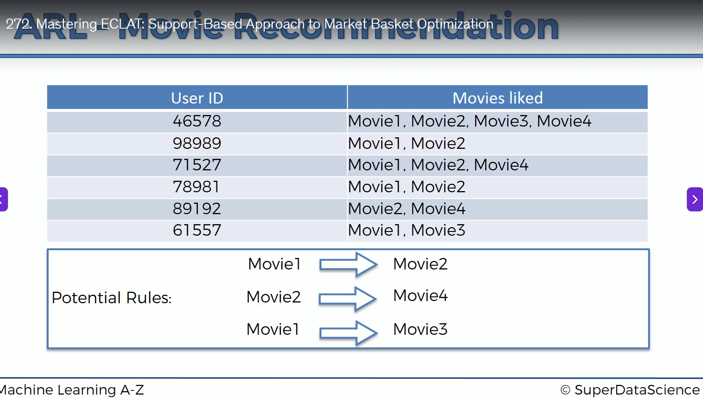
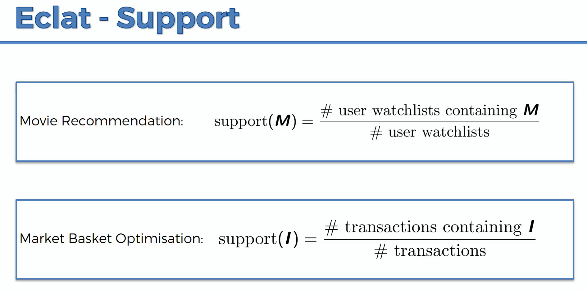
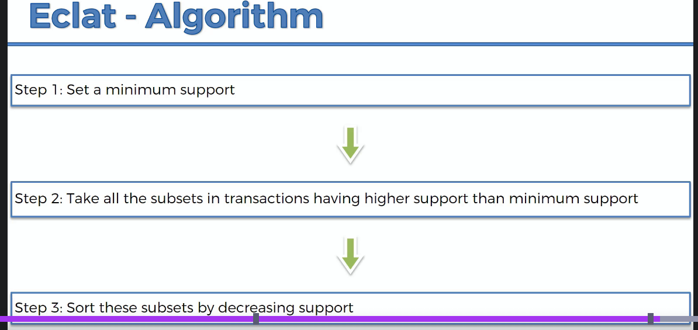
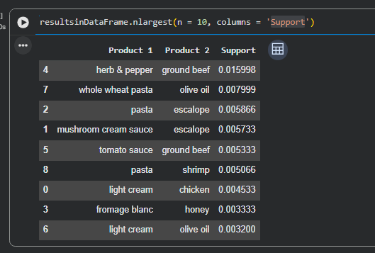
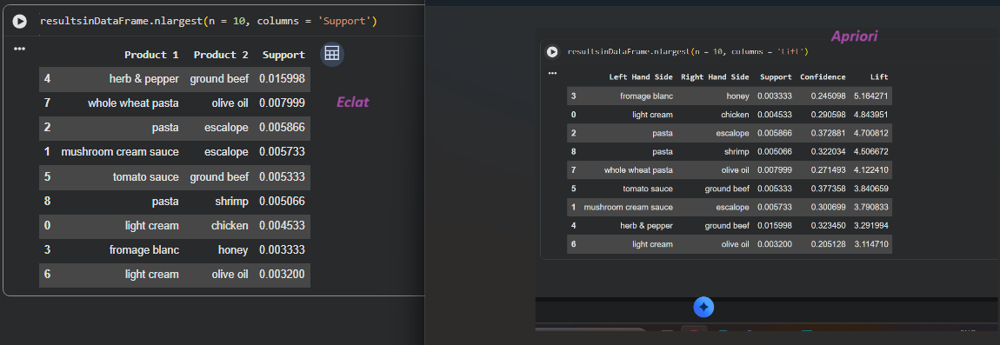

# Association Rule Learning  

People who bought A also bought B. That is what Association Rule.

## Apriori  
Generally, Apriori is an Association Rule Learning algorithm
Apriori algo has 3 parts: supports, confidence and lift

Support:  


Confidence:  
People who brought burger (I1) also brought fries (I2)  


Lift:


It can have multiple items in rule


Lift = Confidence / Support  

Apriori is bit slow algorithm, so, is a product itself has slow success rate, we might not consider them.


``` 
from apyori import apriori
rules = apriori(transactions = transactions, min_support = 0.003, min_confidence = 0.2, min_lift = 3, min_length = 2, max_length = 2)

min_support, min_confidence, min_lift => case by base basis based on data and business case 

min_length => Min num of elements you want to have left or right
max_length => Max num of elements you want to have left or right

Suppose customers purchase:
- Milk + Bread
- Bread + Butter
- Milk + Bread + Butter
Your Apriori algorithm will identify combinations such as:
- Milk → Bread
- Bread → Milk
- Bread → Butter
- Butter → Bread
It will not consider a three-item combination such as Milk + Bread + Butter.

```
After running the above and format, getting this:  



## Eclat



M and I does not mean just 1 movie, set of items set of 2 or more 

<b> People who are watching certain combination of movies how often does this happen </b>



Eclat model is simplified version of Apriori model. Take all the subsets in transactions having higher support than minimum support, and than sort these subsets by decreasing support  
Exactly same formula as apriori:  
``` 
rules = apriori(transactions = transactions, min_support = 0.003, min_confidence = 0.2, min_lift = 3, min_length = 2, max_length = 2)
```

Same as Apriori only remove COnfidance and List related section:
```
def inspect(results):
    lhs         = [tuple(result[2][0][0])[0] for result in results]
    rhs         = [tuple(result[2][0][1])[0] for result in results]
    supports    = [result[1] for result in results]
    return list(zip(lhs, rhs, supports))
resultsinDataFrame = pd.DataFrame(inspect(results), columns = ['Product 1', 'Product 2', 'Support'])
```

column="Support" => will use here instead of "Lift" what we did in Apriori 


Now, check Apiori vs Eclat output to see difference  

If we change min_length above (say 3) will consider 3 item combination  




 


