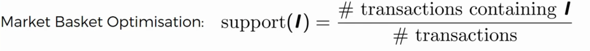
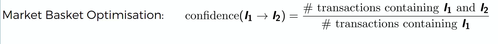
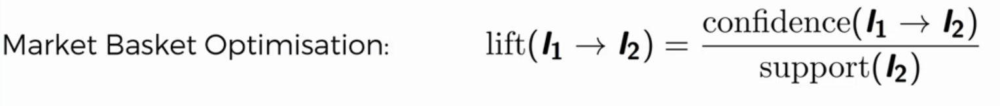

# Association Rule Learning  

People who bought A also bought B. That is what Association Rule.

## Apriori  
Generally, Apriori is an Association Rule Learning algorithm
Apriori algo has 3 parts: supports, confidence and lift

Support:  

Confidence:  
People who brought burger (I1) also brought fries (I2)  

Lift:

Lift = Confidence / Support  

Apriori is bit slow algorithm, so, is a product itself has slow success rate, we might not consider them.  

